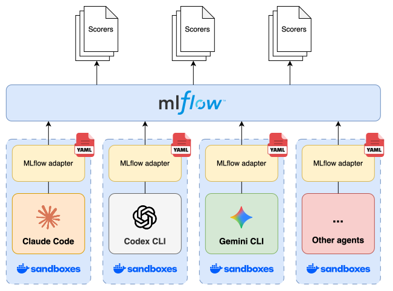

# skill-evals

`skill-evals` evaluates agent skills across models, coding agents, and installation methods. It runs tasks in isolated environments, captures traces, and scores whether an agent selects a skill, follows its instructions, and completes the intended task. Runs without the skill provide a baseline for understanding what changes when it is installed.

The framework ships with Claude Code and Codex harnesses. Library maintainers can test the installation methods their users rely on, while individuals and organizations can compare skills across their own agent setups. Evaluations combine reusable YAML definitions with built-in checks and custom Python scorers.



## Background

Skills are easy to create and distribute, but establishing how well they perform requires testing. Many libraries ship without evaluations, or test only a narrow set of environments. A skill that works with one model and coding agent may not be selected or followed in another setup.

As models improve, the preferred model or harness for a task can change, and multi-agent workflows built with tools such as [Omnigent](https://github.com/omnigent-ai/omnigent) may combine several harnesses from the outset. Evaluating the same cases across these configurations helps establish where skills work well and where adjustments are needed, without repeating setup and scoring by hand.

## Getting started

You need Python 3.12 or newer and [uv](https://docs.astral.sh/uv/). Clone this repository to try the included project before writing your own evaluations.

```bash
git clone https://github.com/maxvandenhoven/skill-evals.git
cd skill-evals
uv run skill-evals validate
```

Validation checks the evaluation and harness definitions, resolves fixtures, and builds scorers without running agents. For the included project, it prints `valid: 2 eval(s), 2 harness(es)`. It does not verify sandbox creation, agent authentication, or model access.

To run agents, install and configure [Docker Sandboxes](https://docs.docker.com/ai/sandboxes/install/), run `sbx login`, and authenticate the agent you want to use through its [agent-specific flow](https://docs.docker.com/ai/sandboxes/agents/). Host agent logins are not a substitute for sandbox authentication.

**Evaluations use model credits or subscription allowances.** The command below runs one code review with the library and one without it, using Codex. Review the project’s harness, library, fixture, and scorer definitions before running an unfamiliar project. Sandbox lifecycle commands can execute on the host, and Python scorers run on the host too. Isolation is not a reason to trust arbitrary evaluation code.

```bash
uv run skill-evals evaluate --evals code-review --harnesses codex -n 1
uv run skill-evals mlflow
```

`evaluate` runs the agents, scores their traces, and saves a Markdown report. In this repository, reports go to `.runs/<stamp>/report.md` and the MLflow store lives in `.mlflow/`. Open `http://127.0.0.1:5000` to inspect traces and assessments after starting the UI. `evaluate` manages an MLflow server for its duration, so you do not need to start the UI first.

### Set up your own project

From the root of a different repository, install the command and initialize its evaluation folders.

```bash
uv tool install skill-evals
skill-evals init tests/skills
```

This writes `.skill-evals.yaml`, copies the harnesses and editor schemas, and creates empty `libraries`, `fixtures`, and `evals` folders. Add definitions based on the [included examples](example/), then run `skill-evals validate` and `skill-evals evaluate`. Initialization does not create a runnable evaluation. By default, run reports go to `.skill-evals/runs/<stamp>/report.md` and the MLflow store goes to `.skill-evals/mlflow/`, so keep `.skill-evals/` out of version control.

## How it works

A project combines five reusable components, with `.skill-evals.yaml` pointing to the folders that hold their definitions.

- **Harnesses** declare the agent, model, execution command, and tracing setup for MLflow. They are independent of a skill library and can be shared across projects.
- **Libraries** declare how skills are installed for each harness, including harness-specific plugin installers, so evaluations can exercise the same installation method as users.
- **Fixtures** prepare the environment a case needs, such as a repository with a feature branch to review.
- **Scorers** evaluate traces for skill invocation, answer content, or tool use. Custom Python scorers can also use an LLM-as-a-judge pattern, with any additional model costs that entails.
- **Evals** define prompts and connect them to libraries, fixtures, and scorers. Together with the selected harnesses and repeat count, they determine the test plan.

For each case and repetition, the framework creates a fresh sandbox for every selected harness and library combination, installs the skills, prepares the fixture, and runs the prompt. The shipped base configuration disables the shared skills store, and runs do not inherit host agent settings. Baselines omit the library under test but retain the agent’s built-in skills. They run by default unless an eval sets `baseline: false`.

Traces go to MLflow, where scorers attach assessments that are collected into the report. The runner also saves agent output, logs, installation inventory, and the workspace for inspection, then removes the sandbox unless `--keep` is set. Treat these outputs as potentially sensitive before sharing them.

An eval with `libraries: []` runs only the baseline, retaining fixtures, harnesses, and scoring tools for broader agent evaluations. Use `uv run skill-evals evaluate --help` for selection, repetition, parallelism, and threshold options.

## Example results

The [example project](example/) evaluates [Matt Pocock’s skill library](https://github.com/mattpocock/skills). Its [code review case](example/evals/code-review.yaml) asks an agent to review a feature branch against a spec and coding standards, then checks whether it invoked the library’s `code-review` skill and included separate Standards and Spec sections. A custom scorer also checks for a matching `git diff` or `git log` tool call. The [PR case](example/evals/pr.yaml) asks for a pull request body and checks skill invocation and the prescribed template without naming the skill in the prompt.

The code review case was previously run three times on Claude Code and Codex, both with and without the library installed. Each harness used the plugin installation commands recommended for it in the library’s README. These are the reported example results, not a benchmark of general review quality.

| Harness | Skills installed | Skill invoked | Expected review format |
| --- | --- | --- | --- |
| Claude Code | No | 0 of 3 | 0 of 3 |
| Claude Code | Yes | 1 of 3 | 1 of 3 |
| Codex | No | 0 of 3 | 0 of 3 |
| Codex | Yes | 3 of 3 | 3 of 3 |

Without the library, both harnesses fail these library-specific checks, as expected. Adding it improved the scores across the three Codex runs, while Claude Code loaded the skill in only one run. Differences in built-in skills could help explain this behavior, since Claude Code also has a built-in `code-review` skill. The invocation scorer requires a namespace here so that the built-in does not count as the library’s skill.

Three runs per configuration are not enough to establish a reliable ranking, and matching review headings does not establish that the review is correct. Installation channels can also deliver different library versions. The example kits document this distinction, and each run records the installed inventory. Inspect those versions and the traces before attributing a difference to the model or harness alone.

To repeat the example comparison with your authenticated agents, run the following command. It makes twelve agent runs and incurs the corresponding usage costs.

```bash
uv run skill-evals evaluate --evals code-review --harnesses claude,codex -n 3
```

## Limitations

Evaluations begin with a single, non-interactive prompt. Agents can use tools while responding, but cases cannot include follow-up user messages, which limits testing of skills that depend on clarification or iterative feedback. MLflow traces can be reviewed manually, but a workflow that pauses for human input or collects human scores needs additional setup.

Scores measure the checks you define, not skill quality in general. Baselines help identify what changes when a library is installed, but built-in skills, installation versions, model behavior, and the chosen cases still affect the result.

## Development

See [CONTRIBUTING.md](CONTRIBUTING.md) for setup, checks, and tests. The unit suite runs with `uv run pytest` and needs no Docker Sandboxes, network access, or model credentials once dependencies are installed. For automated evaluations, see the [headless and CI guide](docs/ci.md), including runner, authentication, and trust requirements.

## License

Licensed under [MIT](LICENSE).
